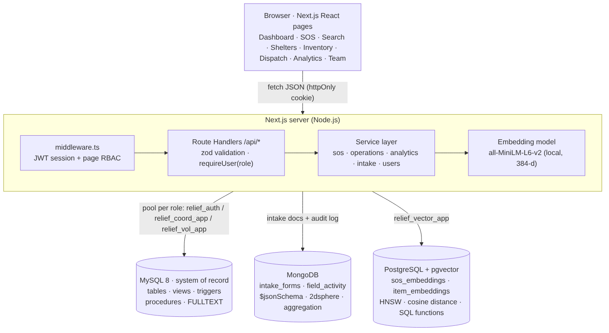

# ReliefOps: Disaster Response & Smart Relief Logistics Engine

**G24 · DBMS Experiential Learning, Level 3 · Sem 5, Sec H · PES University**

| Team member  | SRN           |
|--------------|---------------|
| Shreya C Rao | PES2UG24CS481 |
| Shriya C Rao | PES2UG24CS496 |

ReliefOps lets a city disaster-response team **triage SOS reports, match victims to the nearest shelter with free beds, reserve relief supplies, and dispatch them on vehicles**. Every step is guarded by database rules. It uses three databases, each picked for the kind of data it stores:

| Database | Holds | Why this database |
|---|---|---|
| **MySQL 8** (system of record) | Shelters, stock, reservations, vehicles, dispatch log, users, SOS core facts | The data is strongly related, money-like (stock counts), and must never go negative or be double-booked, so it needs ACID transactions, FKs, CHECKs, triggers and row locks. |
| **MongoDB** | Victim intake forms (household, injuries, needs, disaster-specific fields) and the audit log | Each intake form has a different shape: a varying number of people, nested injury lists, and different fields for a flood than for a landslide. A document fits this naturally, and aggregation pipelines can summarise it. |
| **PostgreSQL + pgvector** (vector DB) | Embeddings of SOS text and relief-item descriptions | Field reports are free text written under stress ("kid burning up"). Keyword search misses them, but cosine similarity on sentence embeddings finds them. pgvector keeps the vectors in ordinary SQL tables with an HNSW index, so similarity search, geo/time filters and fusion of several queries are each a single SQL function call. |



---

## Features

| Area | What it does | Database features shown |
|---|---|---|
| Login & roles | Relief Coordinator / Field Volunteer, bcrypt passwords, JWT httpOnly session | `APP_USER` + CHECKs, **one MySQL account per role** (`GRANT` / roles) |
| New SOS | Form + household table + disaster-specific fields; live **duplicate warning** | `sp_register_sos`, MongoDB `$jsonSchema`, pgvector `find_duplicate_sos()` (cosine + Haversine + time filter) |
| Shelter matching | Nearest active shelter with enough beds; batch auto-match | `sp_match_sos` (transaction, `FOR UPDATE`), `sp_auto_match_unmatched` (**cursor**), Haversine function, triggers flip shelter to *full* |
| SOS page | Intake form, field timeline, **recommended supplies with nearest stock**, similar cases | MongoDB `$push`, pgvector `recommend_items()` (LATERAL multi-query kNN) + MySQL `sp_nearest_stock` |
| Semantic search | Search by meaning next to MySQL keyword search | pgvector `<=>` cosine kNN (HNSW) vs MySQL `MATCH … AGAINST` FULLTEXT |
| Reservations | Reserve stock for an SOS, cancel it | `sp_reserve_supply`, triggers lock + deduct + return stock, low-stock alert trigger |
| Dispatch | Approve on a vehicle, deliver, cancel; fleet status | `sp_approve_dispatch`, `sp_complete_delivery`, 4 dispatch triggers |
| Inventory | Stock health, restock, **atomic transfer**, alerts, new items | `sp_restock`, `sp_transfer_stock` (rollback on CHECK failure), `STOCK_ALERT` |
| Shelters | Occupancy, stock by category, **intake cases within 5 km** | Views + MongoDB `$geoNear` (2dsphere index) |
| Analytics | 8 SQL reports + 5 Mongo pipelines, each with its query shown | JOIN, GROUP BY/HAVING, subqueries, CTE, window functions, `$unwind/$group/$bucket/$filter` |
| Team | Add users, per-person activity, audit log | `v_volunteer_activity`, MongoDB `field_activity` |

---

## Project structure

```
relief-engine/
├── database/
│   ├── sql/
│   │   ├── 01_ddl.sql                 # tables, PK/FK, CHECK, indexes (part 1)
│   │   ├── 02_dml_advanced.sql        # ALTER, data, functions, triggers, procedures, views, queries, roles (part 2)
│   │   └── 03_app_integration.sql     # app views/procedures + one MySQL user per role (part 3)
│   ├── mongo/
│   │   ├── intake_forms.schema.json   # $jsonSchema validator (used by app + scripts)
│   │   └── mongo_shell_demo.js        # mongosh walkthrough: indexes, validation, aggregations, $geoNear
│   └── vector/
│       ├── pgvector_setup.sql         # PostgreSQL: extension, tables, HNSW indexes, search functions, app role
│       └── README.md                  # vector data model + retrieval strategies
├── scripts/                           # npm run seed  (bcrypt hashes, Mongo intake forms, embeddings)
├── src/
│   ├── middleware.ts                  # session check + coordinator-only pages
│   ├── lib/
│   │   ├── db/mysql.ts  db/mongo.ts   # connection pools / client (env vars only)
│   │   ├── vector/embed.ts pgvector.ts # local embeddings + pgvector access
│   │   ├── services/*.ts              # all database logic (sos, operations, analytics, intake, users, activity)
│   │   ├── api.ts  session.ts  validation.ts
│   ├── app/api/**/route.ts            # REST API (31 route handlers)
│   └── app/(app)/**/page.tsx          # UI pages
├── tests/integration.test.mjs         # 20 end-to-end test cases
├── docs/PROJECT_REPORT.md             # full project documentation (+ screenshots, diagrams)
├── docker-compose.yml                 # MongoDB + PostgreSQL/pgvector (optional MySQL)
└── .env.example
```

---

## Setup

### 1. Prerequisites
* **Node.js 18.18+** (20 or 22 recommended)
* **MySQL 8.0.16+** (CHECK constraints are enforced from 8.0.16)
* **Docker Desktop** for MongoDB and PostgreSQL + pgvector, or install them natively (MongoDB 6+, PostgreSQL 14+ with pgvector 0.5+ for HNSW)

### 2. Start MongoDB and PostgreSQL + pgvector
Open `database/vector/pgvector_setup.sql` and change the `relief_vector_app` password in section 5, then:
```bash
docker compose up -d      # first start also runs pgvector_setup.sql inside the Postgres container
```
If you run PostgreSQL natively instead, install pgvector and run `psql -U postgres -f database/vector/pgvector_setup.sql`.
> To redo the vector database with Docker: `docker compose down -v` (deletes the volumes) and `docker compose up -d`.

### 3. Create the MySQL database
Run the three SQL files **in order** as root (MySQL Workbench works too: open each file and execute it).
Before running, open `03_app_integration.sql` and replace the three app passwords in section 5.
```bash
mysql -u root -p < database/sql/01_ddl.sql
mysql -u root -p < database/sql/02_dml_advanced.sql
mysql -u root -p < database/sql/03_app_integration.sql
```
> To start over: `DROP DATABASE disaster_relief; DROP USER relief_auth, relief_coord_app, relief_vol_app; DROP ROLE relief_coordinator, field_volunteer;` and run the three files again.

### 4. Configure environment variables
```bash
cp .env.example .env.local
```
Fill in the three MySQL app passwords (same as in `03_app_integration.sql`), `PG_PASSWORD` (same as in `pgvector_setup.sql`), and generate a session secret:
```bash
node -e "console.log(require('crypto').randomBytes(48).toString('base64url'))"
```
`.env.local` is git-ignored. No credential is written in the source code.

### 5. Install and seed
```bash
npm install
npm run seed
```
`npm run seed` does three things:
1. **MySQL:** replaces the placeholder password hashes with real bcrypt hashes. Every sample user gets `SEED_USER_PASSWORD`, which defaults to `Relief@123`.
2. **MongoDB:** creates the collections with their validator and indexes, writes one intake form per SOS, and links each form through `VICTIM_SOS.intake_doc_ref`.
3. **pgvector:** embeds every relief item and SOS report into `item_embeddings` / `sos_embeddings`.

The first seed downloads the ~23 MB embedding model from Hugging Face and caches it.

### 6. Run
```bash
npm run dev            # http://localhost:3000
# or production:
npm run build && npm start
```

| Demo account | Role |
|---|---|
| `ananya.sharma@relief.org` / `Relief@123` | Relief Coordinator |
| `rohit.verma@relief.org` / `Relief@123` | Relief Coordinator |
| `meera.iyer@relief.org` / `Relief@123` | Field Volunteer |
| `karthik.nair@relief.org`, `farhan.ali@relief.org`, `divya.reddy@relief.org` | Field Volunteer |

### 7. Test
With the app running (`npm start` or `npm run dev`):
```bash
npm test
```
This runs 22 integration tests covering auth, app-level and database-level RBAC, CHECK constraints, triggers, transaction rollback, the Mongo validator, the cross-database SOS flow, semantic search, duplicate detection, recommendations, aggregations, HNSW index use and the vector role's privileges.

---

## Suggested demo flow (10 minutes)
1. **Login as volunteer** (Meera) and open **New SOS**. Type *"Family stuck on the roof, flood water rising, baby needs food"* in Koramangala and the duplicate warning shows SOS #1. Change the text, add household members, and file it. The result card shows the writes to MySQL, MongoDB and pgvector.
2. Go to **Semantic search** and run *"kid burning up with temperature"*. Semantic search finds the child-with-fever report; keyword search finds nothing. In psql, `EXPLAIN` shows the HNSW index (see `database/vector/README.md`).
3. Try **/inventory** as the volunteer: you are redirected. (The DB would also refuse, see test TC04.)
4. **Login as coordinator** (Ananya) and open the new SOS. The recommended supplies show each item, why it matched, and the nearest shelters with stock. Click **Reserve**: the stock is deducted by a trigger. Try a huge quantity: the trigger error is shown.
5. Open **Dispatch**: approve on a vehicle (the vehicle goes *in transit*), then mark it **Delivered** (the reservation becomes *fulfilled* and the vehicle is free again).
6. On **Inventory**, transfer more than exists: the CHECK fails and the whole transaction rolls back.
7. Open **Analytics**: SQL reports and Mongo pipelines, each with *Show query*.
8. Open **Team**: add a user with a bad phone number (rejected), then a valid one. The audit log shows every action.

---

## Security checklist
* Passwords: bcrypt (cost 10), never stored in plain text; timing-safe login with dummy hash; 10-attempt/10-min login throttle.
* Sessions: HS256 JWT in an `httpOnly`, `SameSite=Lax` cookie (`Secure` in production), 8-hour expiry.
* Authorization at **three layers**: middleware (pages), `requireUser(role)` in every API route, and **MySQL privileges** (separate DB accounts per role; volunteers only get views + selected procedures).
* SQL injection: every query is parameterised (`?` placeholders).
* Validation at **two layers**: zod schemas in the API, plus CHECK constraints, triggers and the MongoDB `$jsonSchema` validator in the databases.
* Secrets only in `.env.local` (git-ignored); `.env.example` documents them.

---

## Git workflow (individual contributions)
Both members commit from their own GitHub accounts so the history shows who did what. One person creates the repository and adds the other as a collaborator. Each person then commits the folders they built; [docs/PROJECT_REPORT.md § 15](docs/PROJECT_REPORT.md#15-individual-contributions) has the split and a suggested commit order.
```bash
git init && git branch -M main
git remote add origin https://github.com/<user>/relief-engine.git
git add database/sql/01_ddl.sql && git commit -m "DDL: tables, keys, constraints, indexes"   # whoever wrote it
git push -u origin main
```
Use feature branches (`feat/sql-triggers`, `feat/mongo-intake`, `feat/vector-search`, `feat/dispatch-ui` …) and pull requests for the rest.

See **[docs/PROJECT_REPORT.md](docs/PROJECT_REPORT.md)** for the full documentation.
